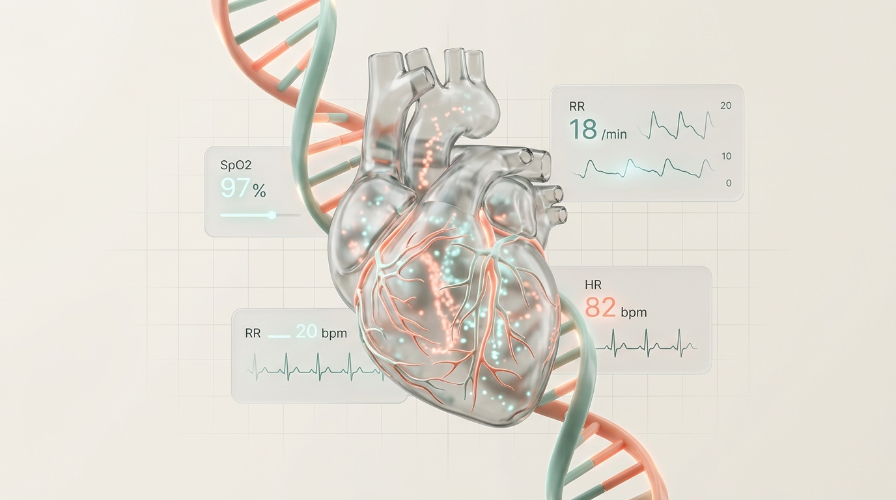
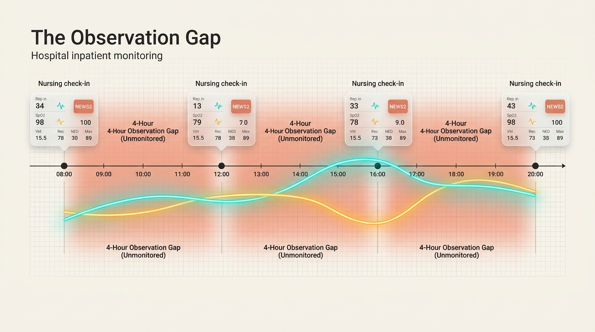
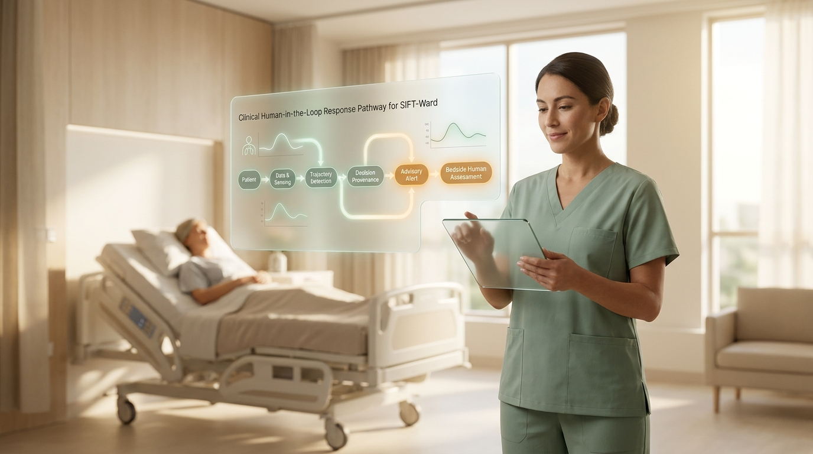
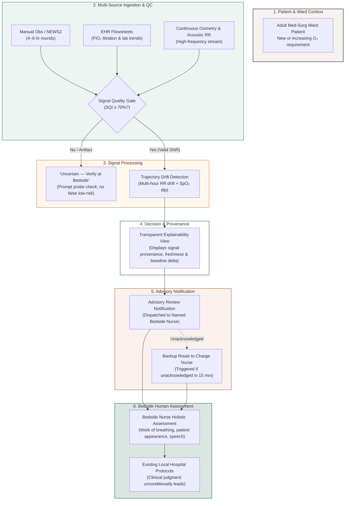
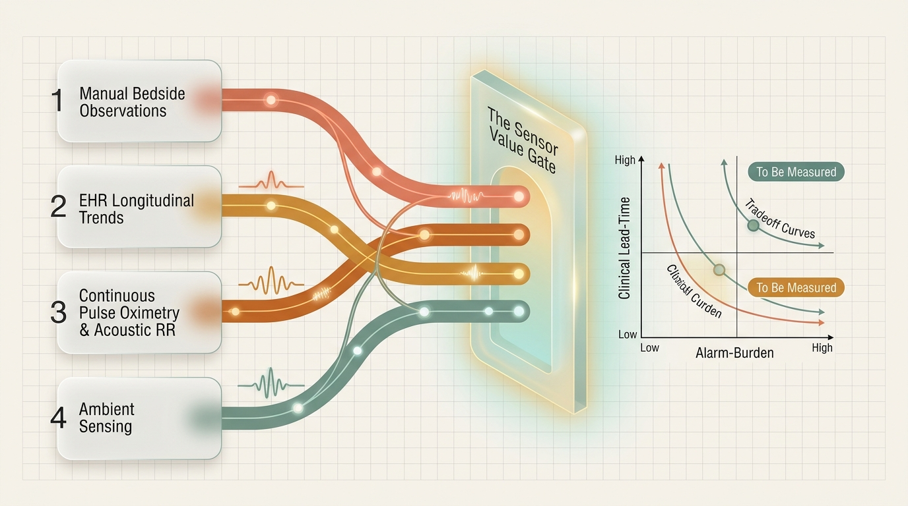
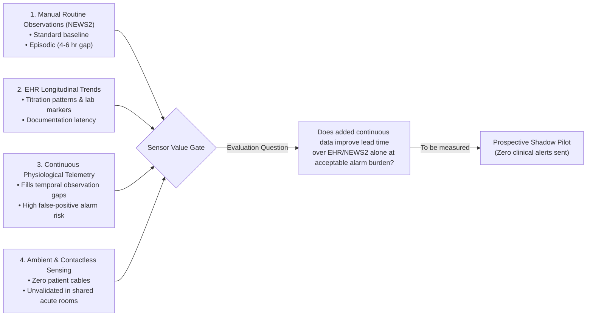

# SIFT-Ward — Clinical Deterioration Early-Warning Dashboard

<div align="center">



### *"Every sensor must earn its alert."*

**A data-quality-aware early-warning pathway for respiratory deterioration on adult hospital wards.**

[](https://react.dev/)
[](https://www.typescriptlang.org/)
[](https://vitejs.dev/)
[](https://www.framer.com/motion/)
[](https://opensource.org/licenses/MIT)
[](#-clinical-safety--governance)

</div>

---

## 📋 Executive Overview

On general medical-surgical hospital wards, clinical observations (such as **NEWS2**) are recorded intermittently—typically every 4 to 6 hours. Between these routine observation rounds, sub-acute respiratory deterioration often develops silently.

**SIFT-Ward** evaluates whether supplementing routine observations with continuous physiological monitoring and longitudinal electronic health record (EHR) trends provides clinicians with actionable warning prior to respiratory-support escalation.

The project’s governing philosophy is the **Sensor Value Gate**:
> **Every added sensor must demonstrate measurable incremental warning value at an acceptable alert burden before it is recommended for hospital deployment.**

---

## 🎯 Target Clinical Cohort & Proposed Endpoint

* **Evaluation Population:** Adult medical-surgical ward patients receiving new or escalating supplemental oxygen therapy.
* **Proposed Evaluation Target:** Unplanned respiratory-support escalation (e.g., non-invasive ventilation, high-flow nasal cannula, or ICU transfer) within a **6-hour prediction window**.
* **Governance Primacy:** SIFT-Ward supports human clinical decision-making. It **does not** diagnose, prescribe medication, titrate oxygen autonomously, or replace existing hospital rapid-response protocols.

---

## ⏱️ The Observation Gap: Silent Trajectories Between Rounds

<div align="center">



</div>

During routine 4-to-6 hour observation windows, episodic charting cannot reveal sub-acute physiological drift. The interactive visualizer contrasts what standard flowsheet records capture at discrete intervals (08:00, 12:00, 16:00, 20:00) against continuous acoustic respiratory rate drift and SpO₂ desaturation occurring inside the gap.

---

## 🔄 End-to-End Application Clinical Flow

<div align="center">



</div>

The diagram below illustrates how signals originate at the patient bedside, pass through the **Signal Quality Filter**, and inform named clinicians under standard hospital operating procedures:



---

## ⚖️ The "Sensor Value Gate": 4 Modality Comparison

<div align="center">



</div>

Before recommending any technology for ward adoption, SIFT-Ward compares four distinct monitoring modalities:



| Modality | Clinical Value | Key Limitations | Proposed Evaluation Role |
| :--- | :--- | :--- | :--- |
| **1. Manually Entered Obs** | Bedside holistic nurse inspection, established hospital standard. | Episodic (4–6 hr gaps); deterioration can develop silently. | **Essential Baseline** that any new tool must complement, never replace. |
| **2. EHR-Based Trends** | Captures longitudinal FiO₂ titration, fluid balance, and lab markers. | Documentation lag during acute interventions; missingness. | **Primary Data Backbone** for feasibility benchmarking. |
| **3. Continuous Physiology** | Fills inter-round gaps with continuous acoustic RR and SpO₂ trends. | Motion artifacts, sensor displacement, alarm fatigue. | **Optional & Selective Gate**; must earn its deployment alert. |
| **4. Ambient Sensing** | Zero adhesive leads or cables; zero patient compliance burden. | Shared-room crosstalk, occlusions, lack of acute inpatient validation. | **Future Research Track**; not included in early hospital pilots. |

---

## 🎨 Visual Identity: "Bioluminescent Organic Clinical"

The design language balances **warm Scandinavian editorial aesthetics** with **calm, precise medical technology**:

* **Warm Alabaster Canvas (`#F6F3EE`):** Grounded by a subtle 30px graph-paper grid (`rgba(44, 62, 53, 0.045)`) and ambient peach/sage blur pools.
* **Dimensional Heart & DNA Helix:** Translucent glass-like anatomical heart with anterior interventricular groove, great vessel arches, and intertwined sage-teal/coral double helix.
* **Coronary Blood Flow Animation:** Bioluminescent light particles navigate the Left Anterior Descending (LAD) artery, Right Coronary Artery (RCA), and Great Cardiac Vein (GCV).
* **VascularFrame Overlay:** Thin, branching anatomical capillary border with animated flowing pulses encasing the live monitoring suite.
* **Typography:**
  * **Plus Jakarta Sans:** Clear, humanist headings, navigation, and body copy.
  * **JetBrains Mono:** Tabular numerals (`font-variant-numeric: tabular-nums`) for vitals, waveform labels, and event logs.

---

## ✨ Interactive Features & Capabilities

1. **Scroll-Linked Story Sequence (`ScrollStoryScene.tsx`):**
   * Multi-stage narrative track transitioning between *The Information Gap*, *Sensor Tradeoffs*, and *The Sensor Value Gate*.
   * Top viewport progress bar smoothly driven by Framer Motion’s `useScroll` and `useSpring`.
2. **Interactive Observation Gap Visualizer (`ObservationGapStory.tsx`):**
   * 12-hour ward shift scrubber (08:00 to 20:00).
   * Contrasts what routine flowsheet charting knows against sub-acute physiological drift developing inside the 4-hour gap.
3. **Simulated Live Telemetry & Scenario Replay Engine (`TrendChart.tsx`):**
   * Real-time rolling telemetry stream updating every ~1.8 seconds.
   * **Scripted 4-Step Narrative Scenario:**
     1. *Baseline Demonstration* (SpO₂ 98%, RR 16 /min)
     2. *Emerging Respiratory Shift* (RR drift to 22 /min, SpO₂ dip to 94%)
     3. *Advisory Trigger* (Appends new review record into the activity log)
     4. *Scenario Completed* (Single-click reset to baseline)
   * Dual-axis SVG graph with **15m / 1h / 6h** time window switcher and individual signal layer toggles.
4. **Vascular Frame (`VascularFrame.tsx`):**
   * Custom branching vein-like SVG perimeter with glowing coral flow pulses.
5. **Activity Log & CSV Export (`ActivityTable.tsx`):**
   * Filter synthetic telemetry events by *All*, *Review Flags*, or *Data Quality*.
   * Export synthetic event rows directly to `sift_ward_synthetic_demo_events.csv`.
6. **Clinical Response Modal (`ResponseWorkflowModal.tsx`):**
   * Accessible dialog with keyboard Escape support, focus trap, and SOP documentation.

---

## 🔒 Clinical Safety & Governance Disclaimers

> ### ⚠️ SYNTHETIC DEMONSTRATION — NOT FOR CLINICAL USE
> * All patient records, identifiers (`Demo patient · R-024`), vitals, waveforms, timestamps, and activity logs are entirely synthetic and illustrative.
> * **No Clinical Claims:** This repository does not display a validated model, calibrated risk score, or claimed reduction in mortality or length of stay.
> * **The Uncertainty Rule:** **Missing, noisy, or disconnected sensor signals mean *uncertain — verify at bedside*, never *low risk*.**
> * **Clinical Primacy:** Clinical judgment and local hospital emergency procedures unconditionally take precedence over all advisory signals.

---

## 🚀 Getting Started

### Prerequisites
* [Node.js](https://nodejs.org/) (v18.0 or later)
* [npm](https://www.npmjs.com/) (v9.0 or later)

### Installation & Launch

```bash
# 1. Clone the repository
git clone https://github.com/rshamith777-cpu/sift-ward-.git
cd sift-ward-

# 2. Install dependencies
npm install

# 3. Start local development server
npm run dev
```

Visit **[http://localhost:3000/](http://localhost:3000/)** in your browser.

### Production Build

```bash
# Typecheck and compile production bundle
npm run build

# Preview production build locally
npm run preview
```

---

## 📁 Repository Structure

```
sift-ward/
├── public/
│   ├── hero-preview.png          # High-resolution clinical hero artwork
│   ├── observation-gap.png       # 12-hour ward shift & gap corridor infographic
│   ├── sensor-value-gate.png     # Multi-tier data stream & evaluation threshold
│   └── clinical-pathway.png      # Bedside human-in-the-loop clinical workflow
├── src/
│   ├── main.tsx                  # Application root
│   ├── App.tsx                   # Master state engine & scroll story orchestration
│   ├── index.css                 # Bioluminescent Organic Clinical design tokens
│   ├── types.ts                  # TypeScript definitions (metrics, trends, scenarios)
│   ├── mockData.ts               # Synthetic baseline data, comparisons & roadmap
│   └── components/
│       ├── HeartHelixArtwork.tsx        # Anatomical heart, DNA helix & blood flow particles
│       ├── VascularFrame.tsx            # Branching vascular SVG border with glowing pulses
│       ├── ObservationGapStory.tsx      # 12-hour shift timeline with interactive scrubber
│       ├── ScrollStoryScene.tsx         # Scroll-linked story sequence
│       ├── TrendChart.tsx               # Real-time dual-axis rolling chart & scenario controls
│       ├── MetricCards.tsx              # Biometric cards with dynamic SVG sparklines
│       ├── PatientContext.tsx           # Fictional patient strip & stream toggle
│       ├── SignalSummary.tsx            # Multi-source synthesis & explainability card
│       ├── SensorValueGate.tsx          # 4-modality matrix & 3-tier value gate
│       ├── ActivityTable.tsx            # Synthetic event table with CSV export
│       ├── ResponseWorkflow.tsx         # 6-step human-in-the-loop response path
│       ├── ResponseWorkflowModal.tsx    # Accessible SOP guideline dialog
│       ├── EvaluationRoadmap.tsx        # 4-phase translation roadmap
│       ├── SyntheticDataBanner.tsx      # Persistent non-clinical demo banner
│       ├── TopNavigation.tsx            # Floating pill header with notifications popover
│       ├── Toast.tsx                    # Accessible feedback announcements
│       └── Footer.tsx                   # Hospital governance disclaimers & footer
├── package.json
├── tsconfig.json
└── vite.config.ts
```

---

## 📜 License

This project is licensed under the [MIT License](LICENSE) — see the LICENSE file for details. Built for healthcare technology research, design evaluation, and clinical workflow demonstration.
